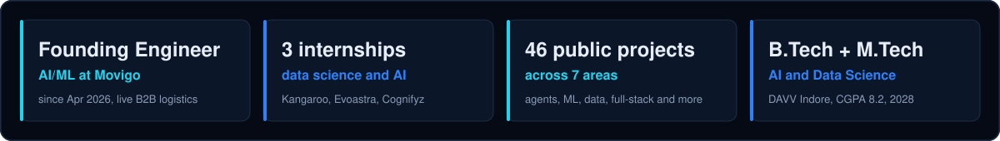
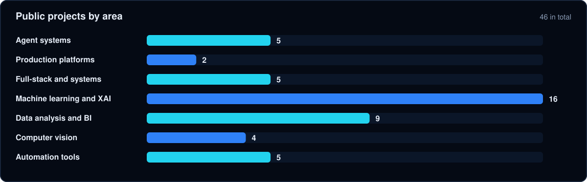
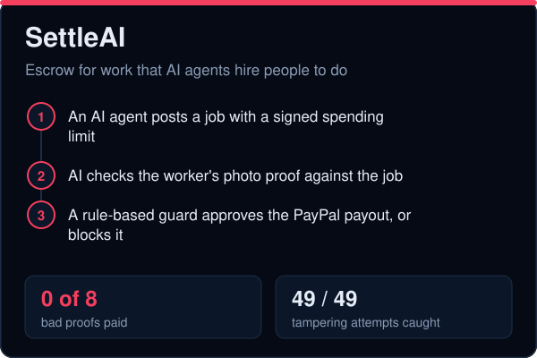
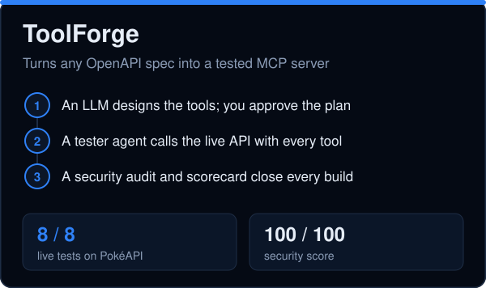
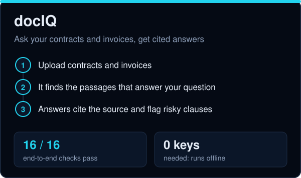
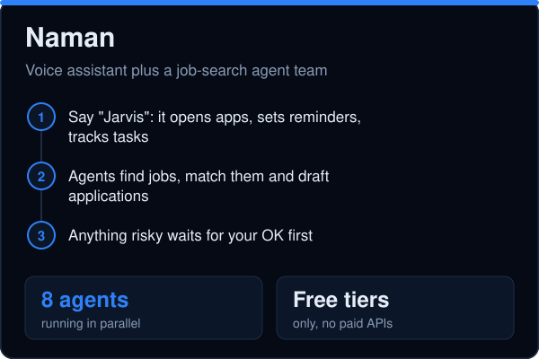
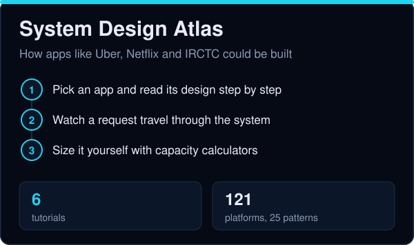
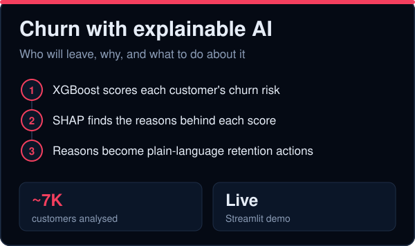

<!--
  Profile README for github.com/Mokshitsharma
  GitHub username used by the live stats cards below: Mokshitsharma
  To change it, find and replace "Mokshitsharma" in this file (stats section and links only).
  Photo: inside assets/hero-banner.svg (from assets/profile-photo.jpg). See README-ASSETS.md.
-->

  

  &nbsp;
  &nbsp;
  &nbsp;
  

## 👋 About

- Integrated B.Tech + M.Tech in **Artificial Intelligence & Data Science** at DAVV, Indore. CGPA 8.2, graduating 2028.
- **Founding Engineer (AI/ML) at Movigo**, a live B2B logistics marketplace in Indore. I built its core platform, an AI voice agent and the surge-pricing model.
- I build **LLM and agentic systems** that check their own work: cited RAG answers, guarded agent payouts, MCP servers tested against real APIs.
- I like the architecture under the model: how requests flow, where a system fails and how to make it recover.
- Goal: production AI systems people can trust with real work.

## 📌 At a glance

## 🛠️ Skills

<table>
<tr><td width="200"><b>🐍 Languages</b></td><td>     </td></tr>
<tr><td width="200"><b>🤖 Agentic AI and LLMs</b></td><td>       </td></tr>
<tr><td width="200"><b>🧠 Machine learning</b></td><td>       </td></tr>
<tr><td width="200"><b>📊 Data and BI</b></td><td>     </td></tr>
<tr><td width="200"><b>🌐 Web and backend</b></td><td>      </td></tr>
<tr><td width="200"><b>🗄️ Databases</b></td><td>    </td></tr>
<tr><td width="200"><b>☁️ Cloud and tools</b></td><td>     </td></tr>
</table>

Badges list tools used in the projects below. AWS: studying for the Machine Learning Engineer Associate (MLA-C02) certification.

## 💼 Experience

### Movigo Innovations Pvt. Ltd.
**Founding Engineer (AI/ML)** · Apr 2026 – Present · Indore

A live B2B intra-city logistics marketplace. The codebase is private, so this is a high-level view only.

- Built the core platform from zero and designed the system architecture
- Built an AI voice agent that resolves ~81% of inbound support calls
- Built the surge-pricing model; improved driver availability and dispatch
- Review code written by 2 full-stack engineers and by AI coding tools

### Kangaroo Software
**Data Scientist Intern** · Dec 2025 – Feb 2026

Built chatbots and ML solutions for client projects.

### Evoastra Ventures
**Artificial Intelligence Intern** · Oct 2024 – Nov 2024

### Cognifyz Technologies
**Data Scientist Intern** · Sep 2024 – Oct 2024

## 🚀 Projects

Grouped the way I work: agent systems first, then the platforms, products, models and analyses around them.

**Jump to:** [Agent systems](#-agent-systems) · [Production platforms](#-production-platforms) · [Full-stack and systems](#-full-stack-and-systems) · [Machine learning and explainable AI](#-machine-learning-and-explainable-ai) · [Data analysis and BI](#-data-analysis-and-bi) · [Computer vision](#-computer-vision) · [Automation tools](#-automation-tools)

### 🤖 Agent systems

LLM agents that plan, use tools and check their own work before acting.

<table>
<tr>
<td width="50%" valign="top">

TypeScript · Next.js · PostgreSQL (PGlite) · PayPal · Groq · MCP 
[Live demo](https://settleai-07ue.onrender.com)

</td>
<td width="50%" valign="top">

Python · LangGraph · MCP · Groq / Gemini / Claude

</td>
</tr>
<tr>
<td width="50%" valign="top">

Node.js · Express · MongoDB · Next.js · Chroma · BullMQ/Redis

</td>
<td width="50%" valign="top">

Python · LangGraph · Groq · Whisper · MCP · Telegram · free tiers only

</td>
</tr>
</table>

| Also in agent systems | What it does | Stack |
|---|---|---|
| [VoiceDesk](https://github.com/Mokshitsharma/VoiceDesk) | Real-time AI voice receptionist for local businesses: answers FAQs, books appointments from natural-language dates, hands off to a human, and lets callers interrupt mid-sentence | WebSocket audio, speech to text, text to speech |

### 🏭 Production platforms

Systems built for real teams and real customers.

| Project | What it does | Stack |
|---|---|---|
| **Movigo** (private) | Live B2B intra-city logistics marketplace in Indore: core platform, AI voice agent, surge-pricing model. See [Experience](#-experience) | |
| [FieldOps AI](https://github.com/Mokshitsharma/FieldOps-AI) | Workforce platform for a field team of about 20: GPS attendance, onboarding, payments, a configurable points engine with 19 scorable actions, live map | Flutter, Next.js, TypeScript, Express, MariaDB, Socket.io |
| [Hyperlocal Marketplace](https://github.com/Mokshitsharma/Hyperlocal-Marketplace) | Customers order from Indore's local shops; riders deliver in about 30 minutes, tracked live on a map. 52/52 backend tests | Full-stack web, MVP build |

### 🧱 Full-stack and systems

<table>
<tr>
<td width="44%" valign="middle">

</td>
<td valign="top">

#### [System Design Atlas](https://github.com/Mokshitsharma/System-Design-Atlas)
Beginner-friendly tutorials on how apps like Uber, Netflix, IRCTC and Rapido could be designed, with interactive diagrams and capacity calculators.

Next.js 16 · React 19 · TypeScript · custom SVG diagram engine 
[Live site](https://sdatlas.vercel.app/)

</td>
</tr>
</table>

| More full-stack and systems | What it does |
|---|---|
| [RouteCore](https://github.com/Mokshitsharma/RouteCore) | Route optimisation and fleet scheduling in Java from scratch: hand-built heap, hash map, k-d tree, Dijkstra/A*, 2-opt. 47 tests, nearest-neighbour 408× faster than brute force at 100k points |
| [Refera](https://github.com/Mokshitsharma/Refera) | Fintech referral platform: lead pipeline, multi-level commissions into an append-only ledger, KYC-gated withdrawals |
| [Dairy Collection Manager](https://github.com/Mokshitsharma/Dairy-Collection-Manager) | Daily milk register, supplier rate charts, per-supplier ledger, advances with EMI recovery. React, Supabase |
| [Portfolio](https://github.com/Mokshitsharma/Portfolio) | Scroll-driven 3D house in three.js with prerendered React pages and case studies |

### 🧠 Machine learning and explainable AI

Models that explain their answers, from tabular ML to multi-model signals.

<table>
<tr>
<td width="44%" valign="middle">

</td>
<td valign="top">

#### [Customer churn with explainable AI](https://github.com/Mokshitsharma/Customer-Churn-XAI)
Predicts which customers will churn, explains why in plain language and maps each reason to a retention action.

XGBoost · SHAP · scikit-learn · Streamlit · ~7K customers 
[Live demo](https://customer-churn-explanation.streamlit.app/)

</td>
</tr>
</table>

| More models | What it does | Stack |
|---|---|---|
| [CricXAI](https://github.com/Mokshitsharma/CricXAI) | Prescriptive ODI cricket strategy: scores every delivery a bowling side could bowl now, for a batsman, bowler type and match situation | FastAPI, ML |
| [Sensei](https://github.com/Mokshitsharma/Sensei) | Trading-intelligence research for Nifty 50 stocks: five model families vote on one explainable BUY/SELL/HOLD signal. For education | PyTorch, SHAP, FinBERT |
| [AI Business Analytics](https://github.com/Mokshitsharma/AI-Business-Analytics) | Upload a CSV or XLSX: cleaning, EDA, automatic model training, SHAP and an AI-written executive report | scikit-learn, SHAP, Gemini |
| [FounderLens AI](https://github.com/Mokshitsharma/FounderLens-AI) | AI data analyst for founders: charts plus Gemini-written insights, risks and actions | Streamlit, Plotly, Gemini |
| [Disaster Response Assistant](https://github.com/Mokshitsharma/Disaster-Response-Assistant) | Emergency guidance chat with live web search, memory and severity scoring | Claude, Streamlit |
| [Finsight](https://github.com/Mokshitsharma/Finsight) | Measures how real-world events moved a stock | Streamlit, Plotly, yfinance |
| [Spam Mail Detector](https://github.com/Mokshitsharma/Spam-Mail-Detector) | TF-IDF with Naive Bayes vs LinearSVC, 96–98% accuracy on UCI SMS Spam | scikit-learn |
| [Credit Card Default](https://github.com/Mokshitsharma/Credit-Card-Default) | Default prediction on 30,000 clients: Logistic Regression vs Random Forest vs XGBoost | scikit-learn, XGBoost |
| [Credit Card Fraud Detection](https://github.com/Mokshitsharma/Credit-Card-Fraud-Detection) | SMOTE plus Random Forest, judged on ROC and precision-recall | scikit-learn, imbalanced-learn |
| [Customer Churn Prediction](https://github.com/Mokshitsharma/Customer-Churn-Prediction) | EDA and churn modelling on the Telco dataset | pandas, scikit-learn |
| [Kaggle Competitions](https://github.com/Mokshitsharma/Kaggle-Competitions) | Stacked HistGradientBoosting + XGBoost regression; blended CatBoost + LightGBM classification | XGBoost, CatBoost, LightGBM |
| [Product Recommendation System](https://github.com/Mokshitsharma/Product-Recommendation-System) | Amazon product recommender with TF-IDF and cosine similarity | scikit-learn |
| [House Price Regression](https://github.com/Mokshitsharma/House-Price-Regression) | Reusable tabular regressor: picks the model with the lower RMSE and saves it | scikit-learn pipelines |
| [Handwritten Digit Classifier](https://github.com/Mokshitsharma/Handwritten-Digit-Classifier) | Scaled SVM on scikit-learn's digits, 98% test accuracy | scikit-learn |
| [Reddit Sentiment Analysis](https://github.com/Mokshitsharma/Reddit-Sentiment-Analysis) | TF-IDF with Logistic Regression and Naive Bayes on 50,000+ Reddit posts | scikit-learn |

### 📊 Data analysis and BI

Questions answered with SQL, Python and Power BI.

| Project | What it does | Stack |
|---|---|---|
| [Paytm stock dashboard](https://github.com/Mokshitsharma/Paytm-stock-dashboard) | Share price since IPO, annotated with key events, against Jio Financial, HDFC Bank, ICICI Bank and SBI | Python ETL, Power BI |
| [NIFTY 50 dashboard](https://github.com/Mokshitsharma/NIFTY50-Dashboard) | Fundamentals and price history for all 50 constituents | pandas, yfinance, Power BI |
| [NIFTY 50 live](https://github.com/Mokshitsharma/NIFTY50-Live) | Polls prices and fundamentals for all 50 stocks every minute | yfinance |
| [Zomato SQL analysis](https://github.com/Mokshitsharma/Zomato-SQL-EDA-Visualization) | ~9,500 restaurants in 15 countries: joins, CTEs and window functions | SQLite, pandas, Seaborn |
| [Lamborghini sales](https://github.com/Mokshitsharma/Lamborghini-sales-analysis) | Customer segments, models, dealer performance against target, marketing ROI | Python, Power BI |
| [BMW sales](https://github.com/Mokshitsharma/BMW-sales-analysis) | Worldwide sales 2010–2024 | pandas, Power BI |
| [YouTube channel analysis](https://github.com/Mokshitsharma/YouTube-Channel-Analysis) | Every video of a channel via the YouTube Data API, engagement metrics | requests, pandas, Power BI |
| [Quick-commerce inventory](https://github.com/Mokshitsharma/Quick-Commerce-Inventory) | 3,732 SKUs cleaned; 12.14% out of stock flagged in a low-stock report | pandas |
| [EDA with pandas](https://github.com/Mokshitsharma/EDA-with-pandas) | Reusable EDA script for any CSV | pandas, matplotlib |

### 👁️ Computer vision

| Project | What it does | Stack |
|---|---|---|
| [Face Attendance](https://github.com/Mokshitsharma/Face-Attendance) | Register faces by webcam, recognise them live, log attendance, export reports by date | face_recognition, OpenCV, SQLite |
| [MoodMate](https://github.com/Mokshitsharma/MoodMate) | Real-time facial emotion detection | Streamlit, deep learning |
| [Face detection](https://github.com/Mokshitsharma/Face-Detection) | Real-time webcam face detection | OpenCV Haar cascades |
| [Motion detection](https://github.com/Mokshitsharma/Motion-Detection) | Highlights moving objects with background subtraction | OpenCV, NumPy |

### ⚙️ Automation tools

| Project | What it does | Stack |
|---|---|---|
| [WhatsApp Bulk Sender](https://github.com/Mokshitsharma/WhatsApp-Bulk-Sender) | Upload a contact list, map columns, send one message with an image to everyone | Full-stack web |
| [WhatsApp automation](https://github.com/Mokshitsharma/WhatsApp-Message-Automation) | Personalised greetings from an Excel contact list | pywhatkit, pyautogui |
| [Indian Stock Lookup](https://github.com/Mokshitsharma/Indian-Stock-Lookup) | Live NSE prices in a Flask site | Flask, yfinance |
| [Stock price CLI](https://github.com/Mokshitsharma/Stock-Price-CLI) | Fundamentals with ticker autocomplete and live price | yfinance, prompt_toolkit |
| [Finance tracker](https://github.com/Mokshitsharma/Finance-tracker) | Income and expense log with a running summary | Python standard library |

## 🏆 Certifications and hackathons

<table>
<tr>
<td width="50%" valign="top">

**Certifications**

- [5-Day AI Agents Intensive](https://drive.google.com/file/d/1NmhjV9PXbdtnp09OdMNtMaizlODUNfke/view?usp=sharing) · Google and Kaggle · Dec 2025
- [Generative AI Foundations](https://drive.google.com/file/d/12LL5X1XFkZa-KYVSoCFUJZ7zyR9aB1wr/view?usp=sharing) · Skillsoft · Nov 2025
- [Generative AI Foundations: IT Integration with Generative AI](https://drive.google.com/file/d/1FGNt8vyrA4aseMvbjoMUgsXYuAgrszPy/view?usp=sharing) · Infosys Springboard · Nov 2024
- [Excel](https://drive.google.com/file/d/1C0E6VwPqfuZyaZkvkLYWOFl5JvfWJ48R/view?usp=sharing) · Infosys Springboard · Nov 2024

In progress: AWS Certified Machine Learning Engineer – Associate (MLA-C02)

</td>
<td width="50%" valign="top">

**Hackathons and competitions**

- **PayPal AI Hackathon 2026**: participant with [SettleAI](https://github.com/Mokshitsharma/settleai)
- **Kaggle Playground Series**: two [competition entries](https://github.com/Mokshitsharma/Kaggle-Competitions)

</td>
</tr>
</table>

## 📈 GitHub activity

<!-- Live cards. Public repos only. Username: Mokshitsharma -->

  
  

  

  

## 🌱 Currently learning and building

- Advanced AI engineering
- Multi-agent systems and LLM architecture
- Production AI systems, cloud and system design
- Preparing for AWS Certified Machine Learning Engineer – Associate

  <b>Building AI agents, RAG or ML systems? Let's talk.</b> 
  Indore, India · IST (UTC+5:30)

  <a href="https://mokshitsharma27.vercel.app/">mokshitsharma27.vercel.app</a> ·
  <a href="https://www.linkedin.com/in/mokshit-sharma-75b5ab305">LinkedIn</a> ·
  <a href="https://github.com/Mokshitsharma">GitHub</a> ·
  <a href="mailto:sharman48520@gmail.com">sharman48520@gmail.com</a>

