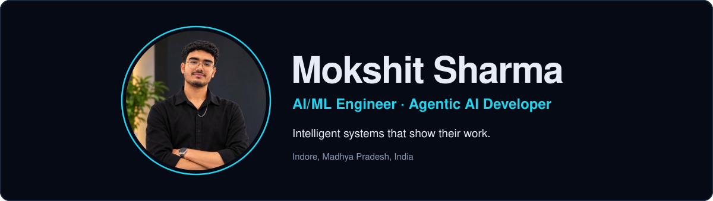
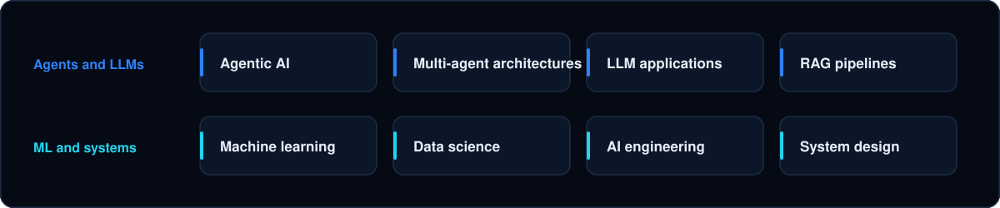
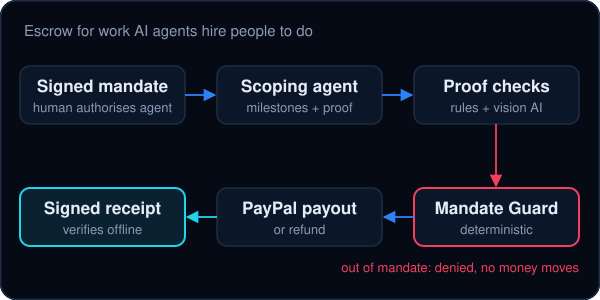
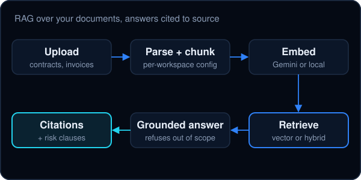
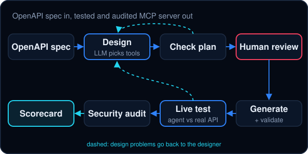
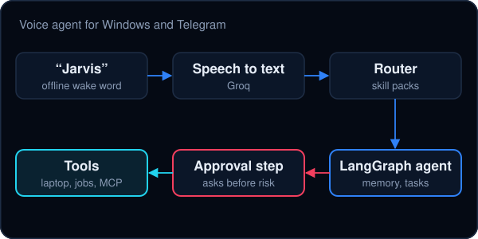
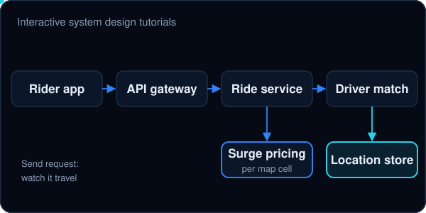
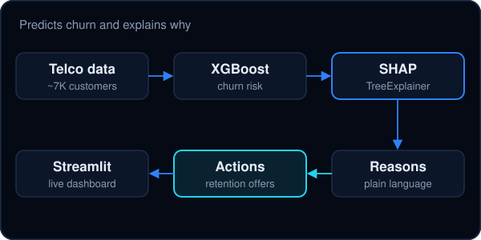
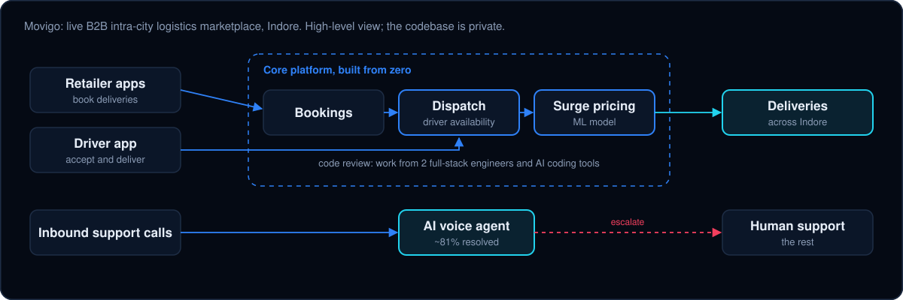

<!--
  Profile README for github.com/Mokshitsharma
  GitHub username used by the live stats cards below: Mokshitsharma
  To change it, find and replace "Mokshitsharma" in this file (stats section and links only).
  Photo: replace assets/profile-photo-placeholder.svg. See README-ASSETS.md.
-->

  

  &nbsp;
  &nbsp;
  &nbsp;
  

## About

- Integrated B.Tech + M.Tech in **Artificial Intelligence & Data Science** at DAVV, Indore. CGPA 8.2, graduating 2028.
- **Founding Engineer (AI/ML) at Movigo**, a live B2B logistics marketplace in Indore. I built its core platform, an AI voice agent and the surge-pricing model.
- I build **LLM and agentic systems** that check their own work: cited RAG answers, guarded agent payouts, MCP servers tested against real APIs.
- I like the architecture under the model: how requests flow, where a system fails and how to make it recover.
- Goal: production AI systems people can trust with real work.

 

## Current focus

## Featured projects

<table>
<tr>
<td width="50%" valign="top">

### SettleAI
Escrow for real-world work that AI agents hire people to do. Built for the PayPal AI Hackathon 2026.

**Problem:** an agent paying a person needs proof the work was done and a clear answer on who is liable when it was not.

**Approach:** AI agents scope jobs and check photo proof; a deterministic Mandate Guard approves every payout; every step becomes a signed receipt that verifies offline.

**Stack:** TypeScript, Next.js, PostgreSQL (PGlite), PayPal, Groq models, MCP

**Results (offline eval):** 28/28 scenarios passed, 0 of 8 bad proofs paid, 49/49 receipt tampering attempts detected

[Repository](https://github.com/Mokshitsharma/settleai) · [Live demo](https://settleai-07ue.onrender.com) · [Screenshot](https://github.com/Mokshitsharma/settleai/blob/HEAD/docs/devpost/2-denied-before-money-moves.png)

</td>
<td width="50%" valign="top">

### docIQ
RAG document intelligence: ask questions of contracts and invoices and get answers cited to the source.

**Problem:** key terms are buried in long documents, and an uncited AI answer can't be trusted.

**Approach:** parse, chunk and embed; vector or hybrid retrieval; grounded answers that refuse out-of-scope questions; automatic risk and clause extraction. Runs offline with no API keys.

**Stack:** Node.js, Express, MongoDB, Next.js, Chroma, BullMQ/Redis, Gemini/Groq

**Results:** 16/16 end-to-end checks pass

[Repository](https://github.com/Mokshitsharma/docIQ)

</td>
</tr>
<tr>
<td width="50%" valign="top">

### ToolForge
Agents that turn an OpenAPI spec into a tested, security-audited MCP server.

**Problem:** thousands of APIs have no MCP server, and writing one by hand is repetitive.

**Approach:** a LangGraph state machine: an LLM designs the tools, a human approves, a tester agent uses the server against the live API, and design problems loop back to the designer. Every build ends with a security audit and a scorecard.

**Stack:** Python, LangGraph, MCP, Groq / Gemini / Claude

**Results:** PokéAPI 8/8 live tests and 100/100 security; Petstore 6/8 after a redesign fixed 2 design bugs

[Repository](https://github.com/Mokshitsharma/ToolForge)

</td>
<td width="50%" valign="top">

### Naman
A voice-controlled AI assistant for a Windows laptop and Telegram.

**Problem:** everyday laptop control, task tracking and job hunting take many small manual steps.

**Approach:** offline wake word, Groq speech to text, a router over skill packs and a LangGraph agent with memory. Risky actions wait for approval in their own graph step. Supports MCP servers.

**Stack:** Python, LangGraph, Groq, Whisper, MCP, Telegram

**Runs on:** free tiers

[Repository](https://github.com/Mokshitsharma/naman-jarvis)

</td>
</tr>
<tr>
<td width="50%" valign="top">

### System Design Atlas
Beginner-friendly system design tutorials: how apps like Uber, Netflix, IRCTC and Rapido could be designed.

**Problem:** most system design material assumes you already know the vocabulary.

**Approach:** nine-section tutorials with interactive workflow diagrams, failure views, capacity calculators and every claim labelled Public, Inferred or Assumption.

**Stack:** Next.js 16, React 19, TypeScript, Zod, custom SVG diagram engine, Vitest, Playwright

**Scope:** 6 tutorials, 121 platforms, 25 architecture patterns

[Repository](https://github.com/Mokshitsharma/system-design-atlas) · [Live site](https://sdatlas.vercel.app/)

</td>
<td width="50%" valign="top">

### Customer churn with explainable AI
Predicts which customers will churn, explains why and suggests what to do.

**Problem:** a churn score alone doesn't tell a retention team what to act on.

**Approach:** XGBoost for risk; SHAP TreeExplainer for per-customer reasons, turned into plain language and mapped to retention actions.

**Stack:** Python, XGBoost, SHAP, scikit-learn, Streamlit

**Data:** telecom dataset, ~7K customers, 19 features

[Repository](https://github.com/Mokshitsharma/Customer_Churn_using_XAI) · [Live demo](https://customer-churn-explanation.streamlit.app/)

</td>
</tr>
</table>

## Experience

### Movigo Innovations Pvt. Ltd.
**Founding Engineer (AI/ML)** · Apr 2026 – Present · Indore

A live B2B intra-city logistics marketplace. The codebase is private, so this is a high-level view only.

- Built the core platform from zero and designed the system architecture
- Built an AI voice agent that resolves ~81% of inbound support calls
- Built the surge-pricing model; improved driver availability and dispatch
- Review code written by 2 full-stack engineers and by AI coding tools

### Kangaroo Software
**Data Scientist Intern** · Dec 2025 – Feb 2026

Built chatbots and ML solutions for client projects.

### Evoastra Ventures
**Artificial Intelligence Intern** · Oct 2024 – Nov 2024

### Cognifyz Technologies
**Data Scientist Intern** · Sep 2024 – Oct 2024

## Technical skills

<table>
<tr><td width="190"><b>Languages</b></td><td> SQL</td></tr>
<tr><td><b>AI / ML</b></td><td> XGBoost, LightGBM, CatBoost, SHAP</td></tr>
<tr><td><b>GenAI / LLMs</b></td><td>RAG, embeddings, hybrid retrieval, Chroma, Groq, Gemini, Claude</td></tr>
<tr><td><b>Agentic AI</b></td><td>LangGraph, MCP, tool design, human-in-the-loop approval, agent evaluation</td></tr>
<tr><td><b>Data science</b></td><td>pandas, NumPy, Plotly, Streamlit, Power BI</td></tr>
<tr><td><b>Databases</b></td><td></td></tr>
<tr><td><b>Cloud & infra</b></td><td> Render, Streamlit Community Cloud</td></tr>
<tr><td><b>Tools</b></td><td></td></tr>
</table>

Familiar with: AWS (studying for MLA-C02), Flask, Express, Next.js, Playwright, Vitest

## GitHub activity

<!-- Live cards. Public repos only. Username: Mokshitsharma -->

  
  

  

  

## Certifications and hackathons

<table>
<tr>
<td width="50%" valign="top">

**Certifications**

- [5-Day AI Agents Intensive](https://drive.google.com/file/d/1NmhjV9PXbdtnp09OdMNtMaizlODUNfke/view?usp=sharing) · Google and Kaggle · Dec 2025
- [Generative AI Foundations](https://drive.google.com/file/d/12LL5X1XFkZa-KYVSoCFUJZ7zyR9aB1wr/view?usp=sharing) · Skillsoft · Nov 2025
- [Generative AI Foundations: IT Integration with Generative AI](https://drive.google.com/file/d/1FGNt8vyrA4aseMvbjoMUgsXYuAgrszPy/view?usp=sharing) · Infosys Springboard · Nov 2024
- [Excel](https://drive.google.com/file/d/1C0E6VwPqfuZyaZkvkLYWOFl5JvfWJ48R/view?usp=sharing) · Infosys Springboard · Nov 2024

In progress: AWS Certified Machine Learning Engineer – Associate (MLA-C02)

</td>
<td width="50%" valign="top">

**Hackathons and competitions**

- **PayPal AI Hackathon 2026**: participant with [SettleAI](https://github.com/Mokshitsharma/settleai)
- **Kaggle Playground Series**: two [competition entries](https://github.com/Mokshitsharma/Kaggle-Competitions)

</td>
</tr>
</table>

## Currently learning and building

- Advanced AI engineering
- Multi-agent systems and LLM architecture
- Production AI systems, cloud and system design
- Preparing for AWS Certified Machine Learning Engineer – Associate

  <b>Building AI agents, RAG or ML systems? Let's talk.</b> 
  Indore, India · IST (UTC+5:30)

  <a href="https://mokshitsharma27.vercel.app/">mokshitsharma27.vercel.app</a> ·
  <a href="https://www.linkedin.com/in/mokshit-sharma-75b5ab305">LinkedIn</a> ·
  <a href="https://github.com/Mokshitsharma">GitHub</a> ·
  <a href="mailto:mokshitsharmalaptop@gmail.com">mokshitsharmalaptop@gmail.com</a>

